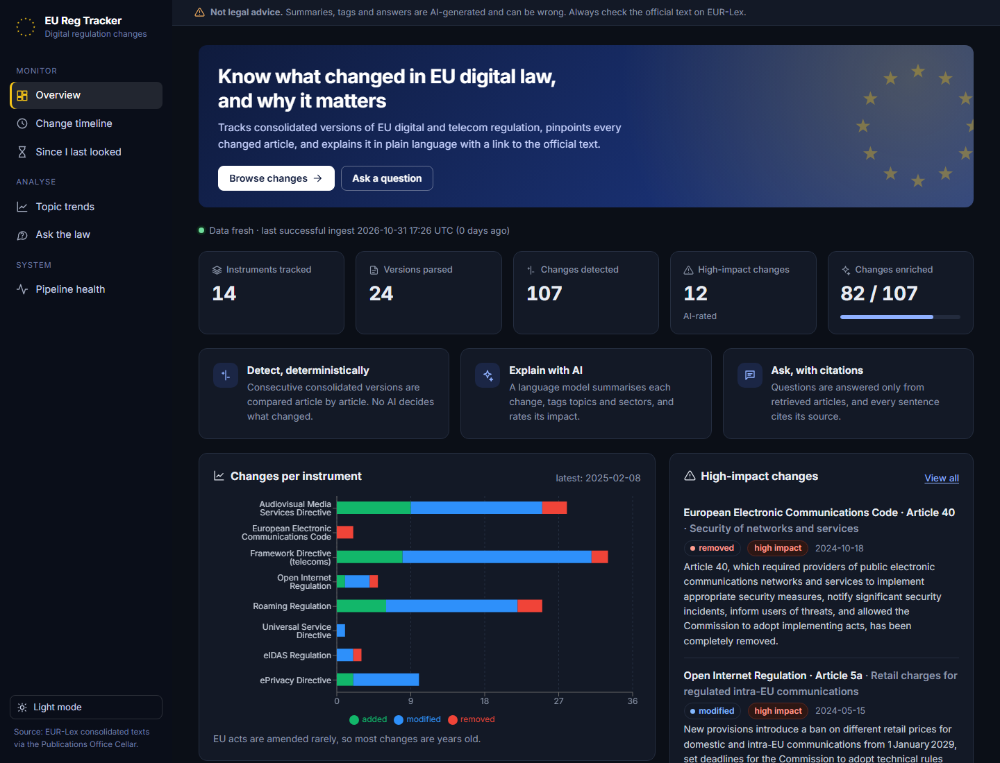
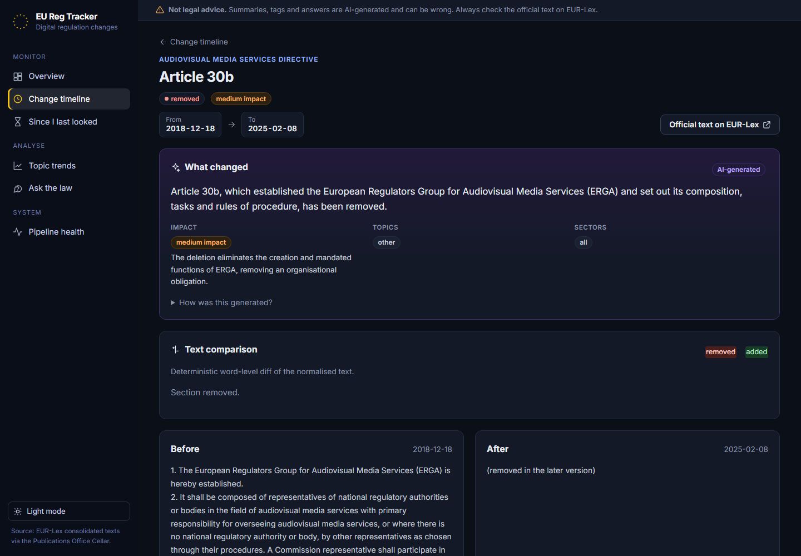
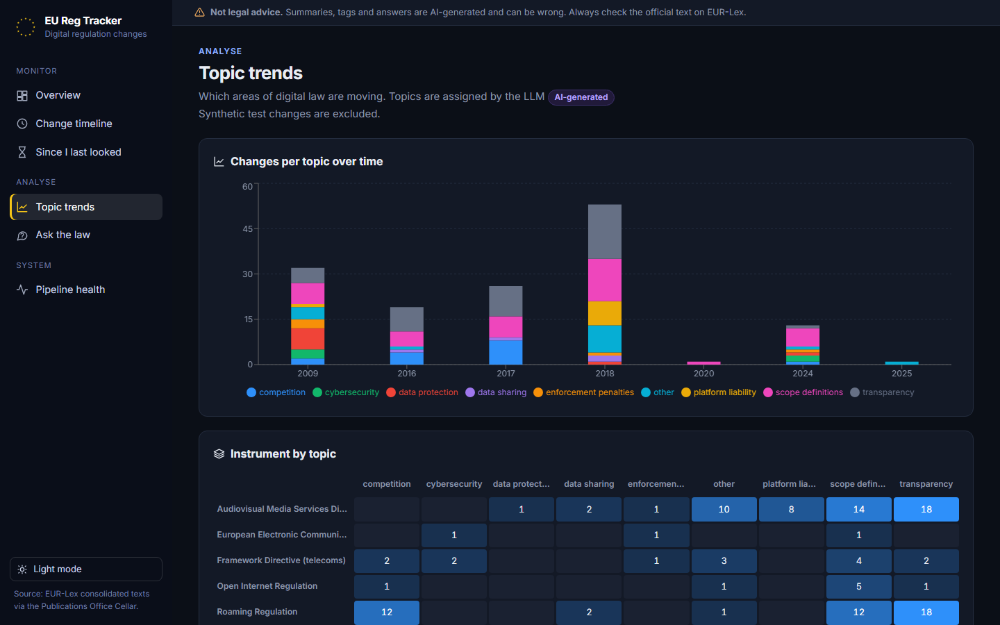
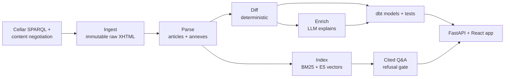

# EU Regulation Change Tracker

Tracks EU digital-policy law article by article: downloads every consolidated version from the
EU Publications Office, finds exactly what changed with a deterministic diff, explains each change
with an LLM (summary, topics, sectors, impact), and answers questions with citations to the exact
article. Built entirely on free infrastructure.

> **Not legal advice.** Summaries, tags and answers are AI-generated and can be wrong. Always check
> the official text on EUR-Lex.



| Change detail: deterministic diff with an AI summary | Topic trends |
|---|---|
|  |  |

## Architecture



Details: [docs/architecture.md](docs/architecture.md) · decisions: [docs/decisions/](docs/decisions/)

## Features

- **Versioned ingestion** of 14 instruments from Cellar (SPARQL discovery, polite fetching,
  SHA-256-deduplicated immutable raw files, every run logged).
- **Robust parsing** of two markup generations (2000s legacy and current), amendment markers
  stripped but recorded per article, repeal notices recognised.
- **Deterministic article-level diff**: added / removed / modified / renumbered, with word-level
  diff HTML. No LLM decides what changed.
- **LLM enrichment** (Groq, OpenAI-compatible): schema-validated summary, topics, sectors, impact
  and rationale; versioned prompt; one validation retry, then an explicit failure row; disk cache;
  token throttle and daily budget; shadow cost at public list prices.
- **Cited Q&A**: hybrid BM25 + E5 retrieval fused with RRF, every sentence cites a passage, a
  citation validator rejects anything outside the retrieved set, and a refusal gate answers "not
  enough evidence" instead of guessing.
- **Web app** (React + TypeScript, served by FastAPI): overview, change timeline with filters
  that live in the URL, side-by-side diff with AI summary,
  topic trends, "since I last looked", Ask, pipeline health; light and dark themes.
  AI output is always badged.
- **Operations**: dbt models with tests and source freshness, Dagster assets with asset checks,
  weekly GitHub Actions run publishing a snapshot to Hugging Face, RSS feed of notable changes.

## Quickstart

```bash
uv sync --all-extras            # or: python -m venv .venv && pip install -e ".[dev,llm,ml,app,pipeline]"
cp .env.example .env            # put your Groq key in LLM_API_KEY and a contact email in USER_AGENT
make demo                       # app on a fixture warehouse at http://localhost:8000 (needs Node 20+)
```

Full pipeline on real data:

```bash
regtracker init-db
regtracker ingest --all         # discover and download consolidated versions
regtracker parse && regtracker diff
regtracker enrich               # LLM explanations (resumable; stops at the daily token budget)
regtracker index                # chunks + embeddings for Q&A
dbt build --project-dir dbt --profiles-dir dbt
regtracker ask "Within how many hours must a personal data breach be notified?"
make app                        # builds frontend/, serves app + API on :8000 (/api/docs)
```

Quality gates: `make check` (ruff, mypy, pytest) and `make dbt-fixture`.

## Design decisions

- **Deterministic diff, LLM only explains.** Every reported change is reproducible from two
  files and auditable; the LLM cannot invent changes.
  ([architecture](docs/architecture.md))
- **Normalize before hashing.** Unchanged articles hash identically across the two markup
  generations (tested on the ePrivacy 2006/2009 pair), so formatting never creates fake changes.
- **DuckDB** single-file warehouse: free, zero-ops, and the whole snapshot is one file
  ([ADR-001](docs/decisions/001-duckdb-over-postgres.md)).
- **Corpus chosen for real version history**: most headline acts (GDPR, DSA, Data Act) have one
  English consolidated version, so the corpus includes acts with real amendment histories
  ([ADR-002](docs/decisions/002-widen-corpus-for-real-changes.md)).
- **Hybrid search with in-process BM25**: works offline and in CI
  ([ADR-003](docs/decisions/003-bm25-in-python.md)).
- **Refuse rather than guess**: weak retrieval never reaches the LLM; invalid citations reject
  the answer; LLM outages degrade to retrieval-only.

## Evaluation

See [docs/eval-report.md](docs/eval-report.md) for full tables and failure analysis.

Measured on 2026-10-31. **Labels and questions are LLM-drafted and not yet human-verified, so
these numbers are provisional.**

| Component | Result |
|---|---|
| Diff | 27/27 versions match independent article counts; 0 false positives in the manual audit after fixes |
| Retrieval (hybrid, 40 questions) | hit@1 0.950, hit@5 1.000, MRR 0.975 (BM25 alone 0.869, vector alone 0.927) |
| Refusal gate (test split) | 20/20 in-scope answered, 5/5 out-of-scope refused |
| Impact rating (37 changes) | accuracy 0.568, within one level 0.973 |
| Topics (37 changes) | micro F1 0.624, macro F1 0.646 |
| Sectors (37 changes) | micro F1 0.253 (definition mismatch, see report) |
| Cost | 1,810 tokens/change, $0.37 shadow cost per 1,000 changes, $0 actual |

## Limitations

- Small change set: EU acts are amended rarely, and several consolidated versions exist only in
  languages other than English (see [docs/sources.md](docs/sources.md)).
- Consolidated texts are documentation tools without legal effect and contain no recitals.
- Gold labels for evaluation were drafted by an LLM and still need human verification; metrics on
  them are provisional (labeled as such).
- Enrichment and embeddings run locally; the weekly cloud run updates ingestion, diffs and dbt.
- The pipeline's daily token budget and the web app's question caps are tracked separately;
  if both use the same API key, their combined use can exceed either limit.

## Data sources and reuse
Legal texts come from the Publications Office of the EU **Cellar** repository (the open store behind
EUR-Lex), fetched via content negotiation on `publications.europa.eu/resource/celex/{CELEX}`.

- EUR-Lex documents may generally be reused for commercial and non-commercial purposes, with credit and
  an indication of any changes, unless otherwise specified (third-party content and some documents, such
  as International Accounting Standards, can carry separate conditions). See the
  [EUR-Lex legal notice](https://eur-lex.europa.eu/content/legal-notice/legal-notice.html) and the
  [Commission legal notice](https://commission.europa.eu/legal-notice_en#copyright-notice).
- Only the electronic Official Journal on EUR-Lex is authentic (since 1 July 2013). Texts and summaries
  here are derived data, not the official version; always check the official source.
- Consolidated versions are not legally binding either; they are documentation tools.
- We fetch politely: descriptive User-Agent, about 1 request per second, cached responses, retries with backoff.

## Deployment (free)

1. Create a Hugging Face **dataset** repo and a write token.
2. In GitHub: repository variable `HF_DATASET_REPO`, variable `USER_AGENT`, secret `HF_TOKEN`.
   The weekly workflow (`.github/workflows/ingest.yml`) then publishes the snapshot.
3. After local enrichment and indexing: `HF_DATASET_REPO=... HF_TOKEN=... regtracker snapshot --upload`.
4. Hugging Face Spaces (Docker SDK, free): create an empty Docker Space, then set the GitHub
   repository variable `HF_SPACE_REPO` (e.g. `you/eu-reg-tracker`). After CI passes on `main`,
   `.github/workflows/deploy-space.yml` uploads the image sources with the Space's README header
   (it can also be run by hand from the Actions tab). The `Dockerfile` builds the React app and the
   API into one image on port 7860.
5. In the Space settings, add the variable `HF_DATASET_REPO` (plus the secret `HF_TOKEN` if the
   dataset is private) and optionally the secret `LLM_API_KEY` for the Ask page. Without a key,
   Ask shows retrieved passages only.

Locally: `docker build -t regtracker . && docker run -p 7860:7860 -e HF_DATASET_REPO=... regtracker`.

Development: `make api` (FastAPI with reload on :8000) and `make frontend-dev` (Vite on :5173,
proxying `/api`). See [ADR-004](docs/decisions/004-fastapi-react-instead-of-streamlit.md).

## License

MIT for the code. Legal texts remain subject to the EUR-Lex reuse conditions above.
