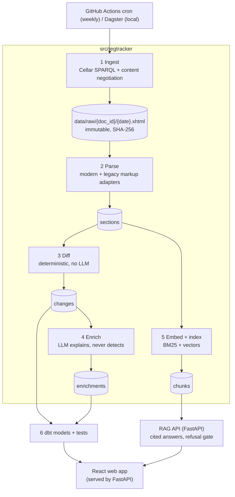

# Architecture

All tables live in one DuckDB file (`data/warehouse.duckdb`, ADR-001). Every stage writes one
`pipeline_runs` row per unit of work (document or version), which feeds freshness checks and the
pipeline-health page.

## Stages

| Stage | Code | Input → output | Idempotency |
|---|---|---|---|
| Ingest | `ingest/discover.py`, `ingest/fetch.py` | CELEX base → `document_versions`, raw XHTML | known `version_id` skipped without a request; same SHA-256 never stored twice; raw files never overwritten |
| Parse | `parse/xhtml_parser.py`, `parse/stage.py` | raw XHTML → `sections` | versions with `parse_status` set are skipped; `--force` rebuilds from raw |
| Diff | `diff/article_diff.py`, `diff/stage.py` | consecutive versions → `changes` | deterministic `change_id`; inserts are `ON CONFLICT DO NOTHING` |
| dbt | `dbt/` | raw tables → `dim_*`, `fct_*`, `mart_*` | views and tables rebuilt each run |

## Design decisions

**Deterministic diffing.** Whether a section changed is decided by key matching and the SHA-256 of
normalized text (NFC, quotes, NBSP, whitespace). The LLM only explains changes the diff has
already found, so every reported change is auditable and reproducible.

**Normalize before hashing.** Two markup variants describe the same law differently. The ePrivacy
2006 text (legacy markup, no ids) and its 2009 version (modern markup) produce identical hashes
for the 13 articles the 2009 amendment did not touch; this is a regression test.

**Markup is not trusted blindly.** Cellar ids can be wrong (Annex IX of the 2018 EECC text has
id `anx_\xa0I`), so annex numbers come from visible titles. Amendment markers (`▼B`, `►M2 ◄`) are
stripped from the text but recorded per section in `amended_by`.

**Renumbering.** A removed and an added section of the same type with word similarity ≥ 0.9 are
reported as one `renumbered` change, not two unrelated ones.

**Repeal is not deletion.** When a consolidated "version" is only a repeal notice, the version is
marked `repealed` (with `repealed_by`) instead of producing a "removed" change for every article.

**Consolidated texts have no recitals.** Only the Official Journal text has them; the corpus uses
consolidated versions, so sections are articles and annexes.
